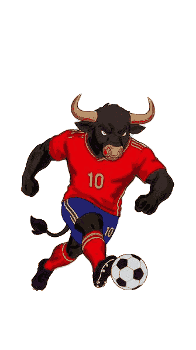
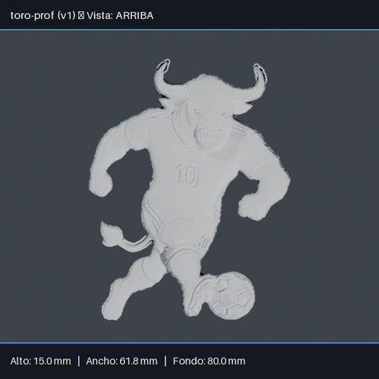

# castkit

**De un dibujo, una foto o una malla 3D a la matriz imprimible y su ficha técnica para colar figuras artesanales.**

`castkit` es una línea de comandos pensada para el operador de un taller que fabrica figuras
coladas en serie: guaguas de pan, apliques, medallas, velas... A partir de un brief (imágenes,
texto o una malla ya hecha) obtiene la malla en bruto, la limpia y escala, genera los renders del
punto de control 1 para aprobarla, y produce la matriz `.stl` lista para imprimir junto con su
ficha técnica.

El flujo, en una línea: `alta → generar → limpieza → control1 → matriz` (con `mecha` para
figuras de cera, y `flujo` para encadenarlo todo de una vez). `castkit version` crea una nueva
versión de un diseño ya existente; `castkit ingesta` se usa en vez de `generar` cuando ya se
tiene la malla en bruto.

### Qué hace hoy

- Molde [abierto (espalda plana, el habitual en el taller) y completo](#dar-de-alta-un-diseño).
- Generación de la malla con los proveedores [`relieve`](#proveedor-relieve-bajorrelieve-por-capas-de-color-diseños-planos),
  [`profundidad`](#proveedor-profundidad-media-figura-para-molde-abierto-desde-una-imagen-frontal),
  [`imagen-3d`, `tripo3d` y `comando`](#proveedores-integrados).
- [Limpieza y escalado de la malla, con respaldo de remallado en Blender](#respaldo-con-blender-remallado-por-vóxeles).
- [Punto de control 1](#punto-de-control-1-renders-de-las-4-vistas-y-aprobación-castkit-control1):
  4 renders con medidas y aprobación antes de pasar a la matriz.
- [Matriz imprimible en modo `figura` o `cubeta` con cavidades](#generar-la-matriz-imprimible-stl-en-modo-figura-o-cubeta)
  y su [ficha técnica](#ficha-técnica).
- [Canal de mecha para figuras de cera](#añadir-el-canal-de-mecha-figuras-de-cera).
- [Versionado de diseños](#crear-una-nueva-versión-de-un-diseño).

### Qué no hace todavía

- Moldes de dos partes ([#14](https://github.com/alexisbanda/castkit/issues/14)).
- Validación automática e informe de la matriz ([#12](https://github.com/alexisbanda/castkit/issues/12)).
- Paquete de fabricación y entrega al taller ([#13](https://github.com/alexisbanda/castkit/issues/13)).
- Estimación de costes ([#16](https://github.com/alexisbanda/castkit/issues/16)).
- Biblioteca de diseños ([#15](https://github.com/alexisbanda/castkit/issues/15)).

Límites actuales: los proveedores locales esperan un fondo liso o transparente
([#54](https://github.com/alexisbanda/castkit/issues/54), [#57](https://github.com/alexisbanda/castkit/issues/57));
`imagen-3d` da figuras toscas; `tripo3d` necesita saldo en la API de Tripo (variable de entorno
`TRIPO_API_KEY`); el remallado de respaldo de Blender casi nunca es fiel
([#28](https://github.com/alexisbanda/castkit/issues/28)). Tampoco se instala todavía como
comando independiente ([#64](https://github.com/alexisbanda/castkit/issues/64)) ni tiene alta
guiada ([#65](https://github.com/alexisbanda/castkit/issues/65)).

### Qué proveedor elegir

| Qué quieres fabricar | Proveedor |
| --- | --- |
| Diseño plano de colores (logo, escudo, medalla) | `relieve` |
| Media figura, desde una imagen frontal o de perfil | `profundidad` |
| Figura completa | `imagen-3d` o `tripo3d` |
| Ya tienes la malla hecha | `castkit ingesta` |
| Herramienta externa propia | `comando` |

### Ejemplo: del dibujo a la matriz

Prueba real del 2026-10-25: a partir del dibujo del toro futbolista (media figura, vista
frontal), un molde abierto de 80 mm de largo y 15 mm de grosor, en silicona, matriz en modo
cubeta con 1 cavidad, para 10 piezas con entrega el 2026-11-15.

```bash
uv sync --extra profundidad
uv run castkit alta toro-prof \
  --brief ~/pedidos/brief-toro \
  --material silicona \
  --tipo-molde abierto \
  --largo-mm 80 \
  --grosor-mm 15 \
  --cavidades 1 \
  --cantidad 10 \
  --fecha 2026-11-15 \
  --licencia propio \
  --origen "dibujo del cliente"
uv run castkit generar toro-prof --proveedor profundidad
uv run castkit limpieza toro-prof
uv run castkit control1 toro-prof
uv run castkit control1 toro-prof --aprobar
uv run castkit matriz toro-prof --modo cubeta
```

`castkit flujo toro-prof --proveedor profundidad --modo cubeta` encadena todo eso, de
`generar` a `matriz`, en un solo comando.

**Aviso:** el dibujo original era una foto de papel con fondo degradado, y le sacaba una placa de
más a la figura (el proveedor `profundidad` toma como fondo el color del borde de la imagen).
Hubo que dejar el fondo transparente antes de generar.

| Dibujo (fondo transparente) | Render del punto de control 1 |
| --- | --- |
|  |  |

`generar` tardó 11,8 s en CPU (malla en bruto de 82 566 caras). La figura limpia quedó en
61,8 × 80,0 × 15,0 mm; la matriz, en 87,8 × 106,0 × 28,0 mm, con unos 177 ml de silicona
estimados y 27,1 cm³ de volumen por figura. En `output/` quedan `toro-prof_v1_matriz.stl`,
`toro-prof_v1_ficha.md` y los cuatro renders del punto de control 1.

## Requisitos

- [uv](https://docs.astral.sh/uv/) para gestionar el entorno y las dependencias (uv descarga automáticamente Python 3.12 si no lo tienes).
- Blender LTS en modo headless, **obligatorio** para los puntos de control (`castkit control1`) y usado también como respaldo de remallado en `castkit limpieza`. La versión exacta requerida está fijada en [`.blender-version`](.blender-version) (por ejemplo, `5.2.2`). Los tests y scripts que lo necesitan lo invocan como subproceso.

## Qué hace cada tecnología

- **trimesh**: carga, revisa y repara mallas (normales, cierre, medidas).
- **manifold3d**: construye los sólidos de fabricación (la resta booleana del canal de mecha, la matriz en modo figura o cubeta multicavidad).
- **Blender** (proceso externo, headless): renderiza las 4 vistas del punto de control 1 (motor `CYCLES` en CPU) y, como respaldo, remalla por vóxeles cuando `castkit limpieza` no logra cerrar la malla en Python.
- **Pillow**: sobreimprime la vista y las medidas en mm sobre cada PNG del punto de control 1.
- **numpy** y **scipy**: apoyan al proveedor local `imagen-3d` (segmentación, transformada de distancia y suavizado para reconstruir un volumen 3D desde una imagen 2D), al proveedor local `relieve` (separar el fondo, componentes conexas, dilatación de la placa) y al proveedor local `profundidad` (máscara, partes finas, campo de alturas).
- **scikit-image**: traza los contornos de cada nivel de altura de los proveedores locales `relieve` y `profundidad` (`skimage.measure.find_contours`).
- **torch** y **transformers** (extra opcional `profundidad`, ver abajo): calculan el mapa de profundidad (Depth Anything V2 Small) del proveedor local `profundidad`. No se instalan por defecto; sin ellas, el resto de castkit funciona igual.

## Instalación

```bash
uv sync
```

Esto instala Python 3.12 (si falta) y todas las dependencias del proyecto, incluidas las de
desarrollo (pytest, ruff), según lo declarado en [`pyproject.toml`](pyproject.toml) y fijado en
`uv.lock`.

### Extra opcional `profundidad` (proveedor de generación 3D)

El proveedor local `profundidad` (ver más abajo) necesita PyTorch y `transformers`, que **no**
se instalan por defecto (para no cargar PyTorch a quien no lo usa):

```bash
uv sync --extra profundidad
```

`pyproject.toml` fija un índice adicional (`pytorch-cpu`, solo para el paquete `torch`, y solo
fuera de macOS, donde las ruedas de PyPI ya son para CPU) para instalar la rueda de PyTorch para
CPU en vez de la variante con CUDA. Sin este extra instalado, el resto de castkit funciona igual
y `castkit generar --proveedor profundidad` termina con un mensaje que explica cómo instalarlo.

## Tests

```bash
uv run pytest
```

Los tests marcados con `blender` ejecutan scripts dentro de Blender como subproceso y se saltan automáticamente, con un motivo visible, si no se encuentra un ejecutable de Blender disponible.

## Lint y formato

```bash
uv run ruff check
uv run ruff format --check
```

## Cómo apuntar a Blender

Castkit localiza el ejecutable de Blender en este orden:

1. La variable de entorno `BLENDER_BIN`, si está definida (debe apuntar a la ruta completa del ejecutable).
2. El comando `blender` disponible en el `PATH` del sistema.

Si no encuentra ninguno, lanza un error explicando cómo instalar Blender LTS (la versión fijada en `.blender-version`) o cómo configurar `BLENDER_BIN`.

## Dar de alta un diseño

`castkit alta` crea la carpeta estándar de un diseño nuevo a partir de su brief:

```bash
# Molde abierto (el habitual: la figura tumbada, cortada por un plano, con la
# espalda plana sobre la placa; ver «Limpiar y escalar la malla automáticamente»)
uv run castkit alta guagua-pan \
  --brief ~/Descargas/brief-guagua \
  --material porcelana-fria \
  --tipo-molde abierto \
  --largo-mm 100 \
  --grosor-mm 20 \
  --cavidades 4 \
  --cantidad 48 \
  --fecha 2026-11-01 \
  --licencia propio \
  --origen "escultura propia en Nomad"

# Molde completo (la figura de pie, entera; para moldes de dos partes, fuera de alcance hoy)
uv run castkit alta guagua-pan-completa \
  --brief ~/Descargas/brief-guagua \
  --material porcelana-fria \
  --tipo-molde completo \
  --alto-mm 80 \
  --cavidades 4 \
  --cantidad 48 \
  --fecha 2026-11-01 \
  --licencia propio \
  --origen "escultura propia en Nomad"
```

Esto crea `guagua-pan/` con:

- `brief/`: copia completa de la carpeta indicada en `--brief`.
- `input/`, `work/`, `output/`: carpetas de trabajo, vacías.
- `CHANGELOG.md`: historial del diseño; la primera entrada registra la creación de la v1.
- `diseno.json`: metadatos del diseño y de cada versión (lo usará el alta de nuevas versiones).

### Tipo de molde (`--tipo-molde`)

Cada diseño tiene un tipo de molde, guardado en su versión:

- **`abierto`** (el habitual en el taller: guaguas, apliques, medallas): una sola pieza, con la
  figura tumbada y cortada por un plano horizontal, dejando la espalda plana sobre la placa.
  Pide `--largo-mm` (obligatorio: la medida mayor de la figura vista en planta) y acepta
  `--grosor-mm` (opcional: lo que la figura sobresale de la placa; sin indicarlo, se usa la
  mitad del grosor total de la figura escalada). No se usa `--alto-mm`.
- **`completo`**: la figura entera, de pie, como se comportaba castkit antes del ticket #55.
  Pide `--alto-mm` (obligatorio). No se usan `--largo-mm` ni `--grosor-mm`.

El tipo efectivo se deduce así, en este orden: si se pasa `--tipo-molde`, se usa ese; si no, pero
se pasó `--largo-mm` o `--grosor-mm`, es `abierto`; si no, pero se pasó `--alto-mm`, es
`completo`; si no se pasó ninguna de las tres, en una terminal interactiva se pregunta el tipo
(proponiendo `abierto` por defecto) y luego la medida que corresponda; sin terminal, se asume
`abierto` y, si falta `--largo-mm`, aparece en la lista de opciones obligatorias faltantes.
Combinar `--tipo-molde completo` con `--largo-mm`/`--grosor-mm`, o `--tipo-molde abierto` con
`--alto-mm`, se rechaza con un mensaje que explica qué medidas lleva cada tipo.

Un diseño dado de alta antes de este ticket (sin `tipo_molde` en su `diseno.json`) se trata
siempre como `completo` y se comporta exactamente igual que antes.

### Opciones

| Opción | Obligatoria | Valores aceptados |
| --- | --- | --- |
| `nombre` (posicional) | sí | minúsculas, números y guiones, sin tildes ni espacios (p. ej. `guagua-pan`) |
| `--brief` | sí | carpeta existente y no vacía |
| `--material` | sí | `porcelana-fria`, `silicona`, `cera` |
| `--tipo-molde` | no | `abierto`, `completo` (ver más arriba cómo se deduce si se omite) |
| `--alto-mm` | sí en molde `completo` | número mayor que 0 |
| `--largo-mm` | sí en molde `abierto` | número mayor que 0: medida mayor de la figura en planta |
| `--grosor-mm` | no (solo molde `abierto`) | número mayor que 0: lo que sobresale de la placa |
| `--cavidades` | sí | entero mayor o igual a 1 |
| `--cantidad` | sí | entero mayor o igual a 1 |
| `--fecha` | sí | fecha de entrega, formato `AAAA-MM-DD` |
| `--licencia` | sí | `propio`, `comercial` |
| `--origen` | sí | texto libre: de dónde viene el modelo base |

Si el nombre no cumple el formato (mayúsculas, espacios, tildes, etc.), el alta se rechaza y
propone un nombre corregido; por ejemplo, «Guagua de Pan» se corrige a `guagua-de-pan`.

Si falta alguna opción obligatoria (incluida la medida que corresponda al tipo de molde) y la
terminal es interactiva, `castkit` la pregunta; si no es interactiva, el alta falla y lista todas
las opciones que faltan. Si el diseño ya existe, no se modifica nada y se avisa del conflicto.

### Dónde se crea el diseño

Por defecto, el diseño se crea en la carpeta actual. Si la variable de entorno
`CASTKIT_DISENOS` está definida, se crea dentro de esa carpeta (debe existir de antemano):

```bash
export CASTKIT_DISENOS=/datos/disenos
uv run castkit alta guagua-pan --brief ... # se crea en /datos/disenos/guagua-pan
```

## Crear una nueva versión de un diseño

`castkit version` crea la siguiente versión de un diseño ya existente, a partir de la versión
actual: parte de sus parámetros, hereda el tipo de molde, el alto/largo/grosor y las cavidades
salvo que indiques nuevos valores, y deja constancia del cambio en `CHANGELOG.md`. La versión
anterior no se modifica.

```bash
uv run castkit version guagua-pan --motivo "aumentar altura a 90 mm" --alto-mm 90

# Cambiar a molde abierto en la nueva versión (las mismas reglas que castkit alta)
uv run castkit version guagua-pan --motivo "pasar a molde abierto" --tipo-molde abierto --largo-mm 100
```

Esto, si `guagua-pan` está en `v1`, deja `version_actual: 2` en `diseno.json` y añade a
`versiones` una entrada `v2` con la fecha de creación, el motivo, el tipo de molde, el
alto/largo/grosor y las cavidades efectivos (el valor indicado por opción, o el de la versión
anterior si no se indicó) y una copia independiente de los parámetros de `v1` (modificarlos en
`v2` no afecta a `v1`). También agrega a `CHANGELOG.md` una entrada `## v2 — AAAA-MM-DD` con el
motivo y, si cambiaron, el tipo de molde y los valores de alto, largo, grosor o cavidades. No se
toca `brief/`, `input/`, `work/`, `output/` ni ninguna versión anterior.

El tipo de molde efectivo de la nueva versión se deduce con las mismas reglas que
`castkit alta` (ver «Tipo de molde» más arriba): si no se pasa `--tipo-molde` ni ninguna medida,
se hereda el tipo de la versión actual; si se pasa `--largo-mm`/`--grosor-mm` sin `--tipo-molde`,
la nueva versión pasa a `abierto`; si se pasa `--alto-mm` sin `--tipo-molde`, pasa a `completo`.
Cambiar de tipo sin indicar la medida que ese tipo necesita (y que la versión anterior no tuviera)
se rechaza.

### Opciones

| Opción | Obligatoria | Valores aceptados |
| --- | --- | --- |
| `nombre` (posicional) | sí | nombre de un diseño ya dado de alta |
| `--motivo` | sí | texto libre: qué cambió en esta versión |
| `--tipo-molde` | no | `abierto`, `completo` (si se omite, se hereda o se deduce de la medida dada) |
| `--alto-mm` | no | número mayor que 0 (si se omite, se copia el de la versión actual) |
| `--largo-mm` | no | número mayor que 0 (si se omite, se copia el de la versión actual) |
| `--grosor-mm` | no | número mayor que 0 (si se omite, se copia el de la versión actual) |
| `--cavidades` | no | entero mayor o igual a 1 (si se omite, se copia el de la versión actual) |

Un `--alto-mm`, `--largo-mm`, `--grosor-mm` o `--cavidades` inválido, o una combinación de
`--tipo-molde` con las medidas del otro tipo, se rechaza con el mismo mensaje que usa
`castkit alta`, y no modifica ni `diseno.json` ni `CHANGELOG.md`. Si falta `--motivo` y la
terminal es interactiva, `castkit` lo pregunta; si no es interactiva, falla pidiendo la opción.
Un motivo vacío o de solo espacios nunca crea la versión. Si el diseño no existe (o el nombre no
es válido), se avisa del error y no se pregunta nada.

### Regla para las etapas del pipeline

A partir del ticket #6, cada etapa del pipeline (limpieza, impresión, etc.) sigue dos
convenciones de `castkit.versiones` para que cada archivo y cada parámetro queden asociados a la
versión que los produjo:

- **Nombrar archivos** con `nombre_archivo(diseno, version, pieza, ext)`, que genera
  `<diseño>_v<versión>_<pieza>.<ext>` (p. ej. `nombre_archivo("guagua-pan", 2, "master", "stl")` →
  `guagua-pan_v2_master.stl`).
- **Registrar los parámetros usados** con `registrar_parametros(carpeta, etapa, parametros)`, que
  guarda `parametros` en `versiones.v<actual>.parametros.<etapa>` del `diseno.json`, sin tocar las
  demás etapas ni otras versiones.

## Entregar la malla en bruto

Si ya cuentas con un `.stl` (de un escaneo 3D, una escultura digital o uno comprado/encargado a
un tercero), `castkit ingesta` lo incorpora a la versión actual del diseño. Si en cambio quieres
que castkit obtenga o genere la malla a partir del brief (imágenes, documentos, texto/prompt),
usa `castkit generar` (ver la sección «Generar la malla en bruto desde el brief» más abajo) en
lugar de `ingesta`.

```bash
uv run castkit ingesta guagua-pan ~/Descargas/guagua.stl
```

Esto, si `guagua-pan` está en `v1`, valida que `~/Descargas/guagua.stl` sea un STL legible
(con al menos una cara; no necesita estar cerrado) y lo copia a
`guagua-pan/input/guagua-pan_v1_bruto.stl` (nombre generado con `nombre_archivo`). Además
registra, con `registrar_parametros` en `versiones.v1.parametros.ingesta`, el nombre original
del archivo, su huella `sha256` y sus `caras` y `vertices`.

Se rechazan, con un mensaje en español y sin copiar ni registrar nada: archivos que no sean
`.stl` (sin distinguir mayúsculas, por ejemplo `.obj`), archivos vacíos, archivos que no se
puedan leer como STL (dañados) y STL sin ninguna cara.

### Opciones

| Opción | Obligatoria | Valores aceptados |
| --- | --- | --- |
| `nombre` (posicional) | sí | nombre de un diseño ya dado de alta |
| `archivo` (posicional) | sí | ruta a un archivo `.stl` existente y legible |
| `--reemplazar` | no | reemplaza sin preguntar la malla ya guardada en la versión actual, si existe |

Si la versión actual ya tiene una malla guardada y no se pasa `--reemplazar`: en una terminal
interactiva se pregunta «¿Reemplazarla? (s/N)» (solo «s», «si» o «sí» reemplazan; cualquier otra
respuesta no modifica nada); sin terminal, falla indicando que hay que usar `--reemplazar`.

## Limpiar y escalar la malla automáticamente

`castkit limpieza` toma la malla en bruto de la versión actual y deja, en `work/`, una malla
cerrada (watertight), escalada al `alto_mm` de la versión y con la base recortada y plana en
z = 0, lista para las siguientes etapas de fabricación:

```bash
uv run castkit limpieza guagua-pan
```

Esto, si `guagua-pan` está en `v1`:

1. Busca la malla en bruto más reciente (la de `v1`; si no la tiene, la de la versión anterior
   más reciente que sí la tenga, avisando en pantalla de cuál se usó).
2. La orienta según `--arriba` (qué eje debe quedar hacia +Z antes de escalar). Si se omite
   `--arriba` (su valor por defecto es «auto»): en molde `completo` equivale a `z` (como
   siempre); en molde `abierto` se elige automáticamente, de la malla en bruto, el eje de menor
   extensión (el grosor de la figura), con signo positivo, para tumbarla con esa cara hacia +Z.
   Un `--arriba` explícito manda siempre sobre la elección automática, en ambos tipos de molde
   (por ejemplo, para darle la vuelta a la figura con `--arriba -y`).
3. La escala de forma uniforme (conservando las proporciones): en molde `completo`, para que su
   altura sea `alto_mm + corte_base_mm`; en molde `abierto`, para que su mayor extensión
   horizontal (X o Y, tras orientarla) sea `largo_mm`.
4. Cierra sus zonas abiertas (huecos), siempre que ninguna supere `agujero_max_mm` de
   perímetro; si alguna lo supera, no cierra nada y falla indicando cuántas zonas hay, su
   posición y tamaño aproximados (en mm) y los siguientes pasos posibles.
5. Recorta la malla con un plano horizontal y la traslada para que el plano de corte quede
   exactamente en z = 0, conservando la parte de arriba (la espalda del molde queda plana). En
   molde `completo` el plano está `corte_base_mm` por encima de la base (como siempre;
   `corte_base_mm` no se usa en molde abierto). En molde `abierto`, con `--grosor-mm` el plano
   deja `grosor_mm` mm por encima (`z_max - grosor_mm`); sin `--grosor-mm`, el plano queda en la
   mitad del grosor total de la figura escalada. Un `--grosor-mm` mayor o igual al grosor total
   disponible se rechaza con un mensaje que indica ese grosor total.
6. La simplifica a `caras_max` caras como máximo (si ya tiene menos, no la toca).
7. Arregla las normales y comprueba que el resultado esté cerrado y tenga volumen positivo.
8. Mide la distancia máxima contra la malla original (orientada, escalada y recortada por el
   mismo plano); si supera `tolerancia_mm`, rechaza el resultado sin escribir ningún archivo.

Si todo sale bien, escribe `guagua-pan/work/guagua-pan_v1_limpia.stl` (nombre generado con
`nombre_archivo`) y registra, con `registrar_parametros` en `versiones.v1.parametros.limpieza`:
`caras_max`, `tolerancia_mm`, `corte_base_mm` (`0` en molde abierto: no se aplica), `agujero_max_mm`,
`arriba` (el eje efectivamente usado), `arriba_automatico` (si se eligió automáticamente),
`tipo_molde`, `largo_mm` y `grosor_mm` (el efectivo; `None` en molde completo),
`plano_corte_mm` (la altura del plano de corte antes de trasladarlo), la versión de la que salió
la malla en bruto (`version_bruto`), su huella `sha256`, las caras resultantes (`caras`) y la
distancia máxima medida (`distancia_max_mm`). Volver a limpiar la misma versión reemplaza el
archivo y el registro, avisando en pantalla.

### Respaldo con Blender (remallado por vóxeles)

Si el cierre rápido en Python (paso 4) no logra dejar la malla cerrada (watertight) y no se pasa
`--sin-blender`, castkit reintenta automáticamente con un **remallado por vóxeles dentro de
Blender** (tamaño de vóxel `voxel_mm`), partiendo de la malla ya orientada y escalada. Si Blender
tampoco está disponible, se devuelve el error original de Python con una nota sobre cómo
instalar Blender LTS o configurar `BLENDER_BIN`.

Cuando se usa este respaldo se registra `metodo: "blender"` y `voxel_mm` (con el cierre en
Python, `metodo` es `"python"` y no se registra `voxel_mm`). La fidelidad, en este caso, se mide
contra la malla original ya orientada y escalada (no contra la remallada): se toma la peor (mayor)
distancia entre esa medición y la del paso 8, y si supera `tolerancia_mm` se rechaza el resultado
sin escribir ningún archivo. Hoy en día este remallado por vóxeles casi nunca entrega piezas
fieles cuando la malla de entrada está muy abierta, y suele terminar fallando con un mensaje que
explica la distancia medida (ver #28).

### Opciones

| Opción | Obligatoria | Valores aceptados |
| --- | --- | --- |
| `nombre` (posicional) | sí | nombre de un diseño ya dado de alta |
| `--arriba` | no | `x`, `-x`, `y`, `-y`, `z`, `-z`: eje que debe quedar hacia +Z (por defecto, «auto»: `z` en molde completo, o el eje de menor extensión en molde abierto) |
| `--caras-max` | no | entero mayor o igual a 1 (si se omite, se usa `config/fabricacion.toml`) |
| `--tolerancia-mm` | no | número mayor que 0 (si se omite, se usa `config/fabricacion.toml`) |
| `--corte-base-mm` | no | número mayor que 0 (si se omite, se usa `config/fabricacion.toml`) |
| `--agujero-max-mm` | no | número mayor que 0 (si se omite, se usa `config/fabricacion.toml`) |
| `--voxel-mm` | no | número mayor que 0: tamaño de vóxel para el remallado de respaldo en Blender (si se omite, se usa `config/fabricacion.toml`) |
| `--sin-blender` | no | desactiva el respaldo con remallado de Blender; si Python no cierra la malla, falla directamente |

Un valor inválido en cualquiera de estas opciones se rechaza con un mensaje en español que
nombra la opción.

### `config/fabricacion.toml`

Los valores de partida de `caras_max`, `tolerancia_mm`, `corte_base_mm`, `agujero_max_mm` y
`voxel_mm` viven, versionados en el repositorio, en la sección `[limpieza]` de
`config/fabricacion.toml`:

```toml
[limpieza]
caras_max = 200000
tolerancia_mm = 0.2
corte_base_mm = 0.5
agujero_max_mm = 10
voxel_mm = 0.3
```

Cada opción de `castkit limpieza` sobrescribe, una a una, el valor correspondiente de aquí; las
demás se siguen leyendo de la configuración.

## Añadir el canal de mecha (figuras de cera)

Cuando el material del diseño es `cera`, `castkit mecha` perfora un canal cilíndrico vertical
pasante por el centro `(x, y)` de la malla limpia de la versión actual
(`work/<diseño>_v<actual>_limpia.stl`), pensado para pasar la mecha de la vela:

```bash
uv run castkit mecha guagua-pan
```

Si el material del diseño es `porcelana-fria` o `silicona`, este paso no modifica la malla
limpia (solo registra que no se aplicó, junto con el material). Lo mismo si el tipo de molde de
la versión actual es `abierto`: el canal de mecha solo tiene sentido en un molde `completo`, así
que `castkit mecha` no perfora nada (avisa en pantalla del motivo y registra `aplicado: false`
con el `tipo_molde` y el `motivo`), sea cual sea el material; termina con código 0. Si el tipo de
molde es `completo` y el material es `cera`:

1. Calcula el espesor mínimo de pared lateral que quedaría entre el canal y el exterior de la
   figura.
2. Si ese espesor es menor que `espesor_minimo_pared_mm` y no se pasa `--forzar`, se detiene: en
   una terminal interactiva pregunta si continuar; sin terminal, falla indicando el espesor
   medido.
3. Resta el cilindro de la malla limpia (resta booleana con `manifold3d`) y comprueba que el
   resultado siga cerrado (watertight) y con volumen positivo.
4. Reemplaza `work/<diseño>_v<actual>_limpia.stl` con la malla ya perforada.

Registra, con `registrar_parametros` en `versiones.v<actual>.parametros.mecha`: si se aplicó
(`aplicado`), el `material`, `diametro_mecha_mm`, `espesor_minimo_pared_mm`, el espesor de pared
realmente medido (`espesor_pared_medido_mm`), el centro del canal (`eje_xy_mm`) y las caras
resultantes.

### Opciones

| Opción | Obligatoria | Valores aceptados |
| --- | --- | --- |
| `nombre` (posicional) | sí | nombre de un diseño ya dado de alta y con malla limpia |
| `--diametro-mm` | no | número mayor que 0 (por defecto `diametro_mecha_mm` en `config/fabricacion.toml`) |
| `--espesor-minimo-mm` | no | número mayor que 0 (por defecto `espesor_minimo_pared_mm` en `config/fabricacion.toml`) |
| `--forzar` | no | continúa sin preguntar aunque el espesor de pared quede bajo el mínimo configurado |

### `[mecha]` en `config/fabricacion.toml`

```toml
[mecha]
diametro_mecha_mm = 3.0
espesor_minimo_pared_mm = 1.2
```

## Generar la malla en bruto desde el brief (con proveedor enchufable)

Cuando el brief contiene imágenes de referencia o generadas con IA (`.png`, `.jpg`, `.jpeg`,
`.webp`), documentos o archivos de diseño (`.pdf`, `.ai`), texto o prompt (`.txt`, `.md`) o
incluso un `.stl` opcional, `castkit generar` obtiene o genera automáticamente la malla en bruto:

```bash
uv run castkit generar guagua-pan --prompt "guagua de pan tradicional sin socavados"
```

- Si en `guagua-pan/brief/` ya hay un `.stl` y no se fuerza `--proveedor`, lo valida y lo guarda
  directamente en `guagua-pan/input/guagua-pan_v1_bruto.stl` (`proveedor: "stl-directo"`).
- Si no hay `.stl`, invoca al **proveedor enchufable** configurado en `[generacion]` de
  `config/fabricacion.toml` (o el indicado con `--proveedor`), valida que el archivo devuelto sea
  un STL legible y lo guarda en `input/` registrando el proveedor, los archivos de `brief/`
  utilizados, el prompt, `sha256`, `caras` y `vertices` en `versiones.v<actual>.parametros.generacion`.

Los `.pdf` y `.ai` del brief solo los recibe el proveedor `comando` (vía la variable de entorno
`CASTKIT_INSUMOS`, ver abajo): los demás proveedores integrados (`imagen-3d`, `relieve`,
`tripo3d`) ignoran documentos y mallas `.stl` del brief, y solo usan la primera imagen de
`brief/` junto con el texto/prompt.

### Proveedores integrados

| Proveedor | Qué usa del brief | Requiere |
| --- | --- | --- |
| `comando` | todos los insumos (imágenes, `.pdf`/`.ai`, prompt); se los pasa a un comando externo | `comando` en `[generacion]`; si está vacío y hay imágenes, recurre a `imagen-3d` |
| `imagen-3d` | solo la primera imagen (reconstructor volumétrico local, sin red) | nada (no necesita claves de API) |
| `relieve` | solo la primera imagen (bajorrelieve local por capas de color, sin red) | molde abierto: `--tipo-molde abierto --largo-mm <mm> --grosor-mm <mm>` (ver abajo) |
| `profundidad` | solo la primera imagen (media figura local por mapa de profundidad, sin red) | molde abierto (igual que `relieve`) y el extra opcional `profundidad` (`uv sync --extra profundidad`) |
| `tripo3d` | la primera imagen (Imagen→3D) o, si no hay imágenes, el prompt (Texto→3D), vía la API v3 de Tripo | variable de entorno `TRIPO_API_KEY` |

El proveedor `tripo3d` pide solo geometría (sin texturas ni PBR), registra `tripo_modelo` y
`tripo_task_id` en `versiones.v<actual>.parametros.generacion`, y gira el GLB descargado de
Y-arriba (convención de glTF/GLB) a Z-arriba (convención de castkit) antes de exportarlo a STL.

El proveedor `comando` ejecuta el comando configurado pasándole, en variables de entorno:
`CASTKIT_SALIDA_STL` (ruta del `.stl` de salida, también como último argumento), `CASTKIT_INSUMOS`
(rutas de imágenes y documentos separadas por `:`, o `;` en Windows) y `CASTKIT_PROMPT` (el texto
combinado del brief más `--prompt`).

#### Proveedor `relieve`: bajorrelieve por capas de color (diseños planos)

`relieve` convierte un diseño plano de colores definidos (logo, escudo, medalla, aplique...) en
un bajorrelieve de espalda plana: cada color pasa a ser un nivel de altura, con aristas nítidas y
una malla cerrada por construcción (sin IA ni servicios externos). Es, por construcción, un
**molde abierto** (ver «Dar de alta un diseño»): la versión actual necesita
`--tipo-molde abierto`, `--largo-mm` (la medida mayor en planta) y `--grosor-mm` (el grosor
final); si el diseño es `completo` o no tiene `grosor_mm`, `castkit generar --proveedor relieve`
termina con un mensaje que explica qué poner.

```bash
uv run castkit alta escudo --brief ./brief-escudo --material porcelana-fria \
  --tipo-molde abierto --largo-mm 70 --cavidades 1 --cantidad 10 --fecha 2026-12-01 \
  --licencia propio --origen "diseño propio"
uv run castkit version escudo --motivo "grosor del relieve" --grosor-mm 6
uv run castkit generar escudo --proveedor relieve
```

En la primera generación, separa el fondo de la imagen (el color conectado al borde; el mismo
color encerrado dentro de la figura, por ejemplo una letra blanca sobre fondo blanco, no es
fondo), reduce el diseño a sus colores planos y propone una altura relativa por color (el de
mayor área es la base; los demás, de más a menos área, suben); escribe la propuesta en
`brief/relieve.toml` y lo dice en el mensaje. El operador edita `altura_mm` de cada color en ese
archivo y vuelve a generar con `--reemplazar` para ajustarlas; las alturas de `relieve.toml` son
relativas entre sí, y castkit las reescala para que la más alta coincida con `grosor_mm`. Se
añaden 0,5 mm de base sacrificable que `castkit limpieza` recorta, dejando la espalda plana y el
grosor exacto (la figura limpia mide `largo_mm` en su lado mayor y `grosor_mm` de alto).

Cada nivel se traza con `skimage` y se contrae `escalon_mm` respecto al de abajo (evita paredes
coincidentes); las manchas menores que `area_min_mm2` se descartan. Las piezas sueltas (islas,
como estrellas separadas del cuerpo principal) se aceptan como piezas independientes y su altura
se limita al nivel más bajo del diseño; si se indica `placa_mm` > 0 en `relieve.toml`, todo el
diseño se apoya en una placa (con la silueta conjunta ampliada `placa_margen_mm`) y la malla
queda en un solo cuerpo.

#### Proveedor `profundidad`: media figura para molde abierto desde una imagen frontal

`profundidad` reconstruye la media figura de un molde abierto (espalda plana) a partir de una
imagen frontal: un mapa de profundidad local da las formas grandes (cara, manos, cuerpo) y el
sombreado de la propia imagen realza los motivos finos que la profundidad por sí sola suaviza.
Es, igual que `relieve`, un **molde abierto**: la versión actual necesita `--tipo-molde abierto`,
`--largo-mm` y `--grosor-mm`; si el diseño es `completo` o no tiene `grosor_mm`,
`castkit generar --proveedor profundidad` termina con un mensaje que explica qué poner.

Necesita el extra opcional `profundidad` (`uv sync --extra profundidad`, ver «Instalación»): sin
él instalado, el resto de castkit funciona igual y el comando termina con un mensaje en español
que explica cómo instalarlo:

```
El proveedor profundidad necesita el extra opcional: uv sync --extra profundidad
```

```bash
uv sync --extra profundidad
uv run castkit alta guagua --brief ./brief-guagua --material cera \
  --tipo-molde abierto --largo-mm 100 --cavidades 1 --cantidad 10 --fecha 2026-12-01 \
  --licencia propio --origen "ilustración propia"
uv run castkit version guagua --motivo "grosor de la media figura" --grosor-mm 20
uv run castkit generar guagua --proveedor profundidad
```

El modelo de profundidad es **Depth Anything V2 Small** (`depth-anything/Depth-Anything-V2-Small-hf`,
licencia Apache-2.0, uso comercial permitido) fijado por `revision` (el commit del modelo en
Hugging Face). Las variantes Base y Large del mismo modelo (y cualquier otro) tienen licencia
CC-BY-NC (solo uso no comercial) y `config/fabricacion.toml` los rechaza con un mensaje que
explica la licencia; `modelo` y `revision` no se pueden cambiar a otro modelo.

En la primera generación, calcula el mapa de profundidad en CPU (unos 30 s por imagen) y escribe
los valores de altura de `[profundidad]` en `brief/profundidad.toml`. El operador edita ese
archivo y vuelve a generar con `--reemplazar` para ajustarlo: `borde_mm` es la altura mínima (el
borde de la figura) y `grosor_mm` del diseño es el máximo; entre ambos se reparten la forma
(profundidad, normalizada por percentiles) y `realce_mm` del realce del sombreado. `suavizado`
(sigma, en píxeles de la resolución de trabajo) suaviza el campo de alturas; `ancho_min_mm` y
`engrose_mm` ensanchan las partes más finas que esa medida (para que no desaparezcan al moldear);
`mm_por_px` fija la resolución de trabajo del campo de alturas (no la de la imagen de entrada).
Como en `relieve`, se añaden 0,5 mm de base sacrificable que `castkit limpieza` recorta, dejando
la espalda plana y el grosor exacto. La huella en planta sale de trazar el contorno como un
polígono suavizado (no por celdas de píxel): la pared queda lisa y el borde superior, interpolado
del campo de alturas, sin escalones (el campo se extiende fuera de la figura con un difusor, no
con un vecino más cercano, para que esa extensión no deje escalones ni una cresta en la pared). La
malla final se simplifica con `tolerancia_mm` para no pasar de `caras_max` caras. La etapa
`generacion` registra el modelo, la `revision`, el `sha256` de la imagen y de `profundidad.toml`,
los parámetros usados y los segundos de cálculo.

### Opciones de `castkit generar`

| Opción | Obligatoria | Valores aceptados |
| --- | --- | --- |
| `nombre` (posicional) | sí | nombre de un diseño ya dado de alta |
| `--proveedor` | no | `comando`, `imagen-3d`, `relieve`, `profundidad`, `tripo3d`, o un proveedor registrado en tiempo de ejecución (si se omite, se usa `config/fabricacion.toml`) |
| `--prompt` | no | texto o prompt de contexto adicional para el generador 3D |
| `--reemplazar` | no | reemplaza sin preguntar la malla ya guardada en la versión actual, si existe |

### `[generacion]` en `config/fabricacion.toml`

```toml
[generacion]
proveedor = "comando"
comando = ""
tripo_modelo = "v2.5-20250123"
tripo_espera_max_s = 600
```

- `proveedor`: proveedor por defecto cuando no se pasa `--proveedor`.
- `comando`: comando externo para el proveedor `comando` (ver arriba); si está vacío, recurre a
  `imagen-3d` cuando hay imágenes en el brief.
- `tripo_modelo`: versión del modelo de Tripo3D (API v3) usada por el proveedor `tripo3d`.
- `tripo_espera_max_s`: plazo máximo, en segundos, que el proveedor `tripo3d` espera a que la
  tarea termine antes de fallar.

### `[relieve]` en `config/fabricacion.toml`

Valores por defecto que el proveedor `relieve` copia a un `brief/relieve.toml` nuevo (ver arriba):

```toml
[relieve]
colores_max = 8
base_mm = 2.0
paso_mm = 0.4
escalon_mm = 0.05
area_min_mm2 = 0.5
placa_mm = 0
placa_margen_mm = 1.0
```

- `colores_max`: número máximo de colores planos al reducir la imagen (`Image.quantize`).
- `base_mm`: altura relativa propuesta para el color de mayor área (la base del relieve).
- `paso_mm`: milímetros que sube la altura propuesta de un color al siguiente, de más a menos
  área (los detalles pequeños quedan más altos).
- `escalon_mm`: milímetros que se contrae cada nivel respecto al de abajo (evita paredes
  coincidentes entre niveles).
- `area_min_mm2`: área mínima, en mm², de una mancha de color para que no se descarte (limpia el
  antialias y el ruido de la imagen).
- `placa_mm`: grosor de la placa de apoyo; `0` = sin placa (las islas quedan limitadas a la
  altura base).
- `placa_margen_mm`: margen de la placa alrededor de la silueta conjunta del diseño (si
  `placa_mm` > 0).

Estos mismos valores (salvo `colores_max`, que solo se usa al proponer) se guardan también, ya
resueltos, en cada `brief/relieve.toml` (ver arriba).

### `[profundidad]` en `config/fabricacion.toml`

Valores por defecto que el proveedor `profundidad` copia a un `brief/profundidad.toml` nuevo
(ver arriba):

```toml
[profundidad]
modelo = "depth-anything/Depth-Anything-V2-Small-hf"
revision = "5426e4f0f36572d16453bbda7a8389317b1bef99"
borde_mm = 4.0
realce_mm = 1.2
suavizado = 0.6
ancho_min_mm = 2.5
engrose_mm = 0.6
mm_por_px = 0.2
tolerancia_mm = 0.03
caras_max = 120000
```

- `modelo`: único modelo admitido (licencia Apache-2.0); las variantes Base y Large (licencia
  CC-BY-NC, no comercial) se rechazan con un mensaje que explica por qué.
- `revision`: revisión (commit) fija del modelo en Hugging Face.
- `borde_mm`: altura (mm) del punto más bajo de la figura (el borde); `grosor_mm` del diseño es
  el máximo.
- `realce_mm`: milímetros, entre `borde_mm` y `grosor_mm`, dedicados a realzar los motivos finos
  a partir del sombreado de la imagen.
- `suavizado`: sigma (en píxeles de la resolución de trabajo) del suavizado gaussiano del campo
  de alturas.
- `ancho_min_mm`: partes de la figura más estrechas que esto (mm) se ensanchan (ver `engrose_mm`).
- `engrose_mm`: milímetros que se ensancha, por lado, cada parte más estrecha que `ancho_min_mm`.
- `mm_por_px`: resolución de trabajo (mm por píxel) del campo de alturas; no es la resolución de
  la imagen de entrada, sino la de la malla (más fino = más detalle y más memoria/tiempo).
- `tolerancia_mm`: tolerancia (mm) con la que se simplifica la malla final (`Manifold.simplify`):
  ninguna superficie se mueve más que esto. Si no basta para bajar de `caras_max`, se sube
  automáticamente (hasta 8 veces) antes de generar.
- `caras_max`: número máximo de caras de la malla en bruto (antes de `castkit limpieza`). Si
  `tolerancia_mm` no alcanza para bajar de este límite, se sube automáticamente; si aun así no
  alcanza, la generación falla (sube `caras_max` o reduce `mm_por_px`).

Estos mismos valores se guardan también, ya resueltos, en cada `brief/profundidad.toml` (ver
arriba).

## Punto de control 1: renders de las 4 vistas y aprobación (`castkit control1`)

Antes de imprimir o pasar a la caja de molde (`castkit matriz`), `castkit control1` genera sin abrir interfaz gráfica cuatro imágenes PNG de la malla limpia de la versión actual (`frente`, `perfil`, `arriba` y `3-4`) en `output/`, con las medidas finales de **alto, ancho y fondo en mm** sobreimpresas de forma legible:

```bash
# Generar las 4 vistas y aprobar la versión actual
uv run castkit control1 guagua-pan --aprobar

# Rechazar la versión actual registrando el motivo (bloquea el paso a la matriz)
uv run castkit control1 guagua-pan --rechazar --motivo "la cara quedó aplastada"
```

Los cuatro archivos se guardan en `output/` nombrados con la versión actual:
- `guagua-pan_v1_render-frente.png`
- `guagua-pan_v1_render-perfil.png`
- `guagua-pan_v1_render-arriba.png`
- `guagua-pan_v1_render-3-4.png`

La decisión (`aprobado`, `rechazado` con motivo obligatorio, o `pendiente`) y la fecha quedan registradas en `versiones.v1.parametros.control_1` dentro de `diseno.json`. Mientras el punto de control 1 no se haya ejecutado, o esté pendiente o rechazado, `castkit matriz` rechaza generar la matriz e informa del motivo. `castkit flujo` también se detiene en este punto: en una terminal interactiva pregunta si apruebas la figura, y en scripts o CI solo avanza a la matriz si se le pasa `--aprobar-control1`.

Los renders se generan **siempre con Blender** en modo headless (motor `CYCLES` en CPU): no hay ningún motor de respaldo. Si Blender no está instalado o no se encuentra, `castkit control1` falla con un mensaje que explica cómo instalar Blender LTS (la versión fijada en `.blender-version`) o cómo configurar `BLENDER_BIN`; si Blender falla o se cuelga, el error incluye el detalle (y, si se agotó el tiempo de espera, los segundos). En ningún caso deja PNG a medio generar.

### Opciones de `castkit control1`

| Opción | Obligatoria | Valores aceptados |
| --- | --- | --- |
| `nombre` (posicional) | sí | nombre de un diseño ya dado de alta y con malla limpia |
| `--aprobar` | no | aprueba el punto de control 1 y habilita el paso a `castkit matriz` |
| `--rechazar` | no | rechaza el punto de control 1 y deja el diseño sin avanzar |
| `--motivo` | sí (si se usa `--rechazar`) | texto libre explicando qué corregir |

## Generar la matriz imprimible (`.stl`) en modo `figura` o `cubeta`

Una vez limpia la malla (`work/<diseño>_v<actual>_limpia.stl`), `castkit matriz` construye el
archivo `.stl` final de la matriz para mandarlo a la impresora 3D, ya sea en filamento (FDM) o
en resina (MSLA):

```bash
# Modo figura: solo la figura apoyada sobre su base plana
uv run castkit matriz guagua-pan --modo figura

# Modo cubeta: una sola pieza con base + 1 o N figuras (según cavidades) + pared alrededor
# lista para verter la silicona líquida directamente
uv run castkit matriz guagua-pan --modo cubeta
```

Si no se indica `--modo` y la terminal es interactiva, `castkit matriz` pregunta antes de crear:
`¿Qué tipo de matriz deseas crear (figura, cubeta)?`.

El resultado se guarda en `guagua-pan/output/guagua-pan_v1_matriz.stl` (cerrado y apoyado en
`z = 0`) y registra en `versiones.v1.parametros.matriz` el modo elegido, las cavidades, los
parámetros geométricos en mm, las dimensiones exteriores, el volumen de una figura en cm³ y (en
modo `cubeta`) los mililitros estimados de silicona.

Los modos `figura` y `cubeta` escriben siempre el mismo archivo,
`output/<diseño>_v<actual>_matriz.stl`: generar un modo después del otro para la misma versión
sobrescribe el `.stl` anterior (el segundo modo pisa al primero). Si necesitas conservar ambos,
copia el `.stl` a otro nombre antes de generar el segundo modo.

### Ficha técnica

Junto al `.stl`, `castkit matriz` escribe `output/<diseño>_v<actual>_ficha.md`: una ficha técnica
en Markdown con el material final de la figura, el modo de matriz impresa, las cavidades en la
matriz, el tipo de molde y sus medidas, las dimensiones exteriores de la matriz, el volumen por
figura en cm³, (en modo `cubeta`) la silicona líquida estimada en ml, el nombre del archivo `.stl`
y una advertencia de taller según el material (por ejemplo, verificar que el canal de mecha quede
despejado antes de verter la silicona en figuras de cera, o aplicar desmoldante obligatoriamente
en moldes de silicona sobre silicona). En molde `completo` muestra «Tipo de molde: completo» y
«Altura objetivo de figura: … mm»; en molde `abierto`, «Tipo de molde: abierto», «Largo de la
figura: … mm» y «Grosor de la figura: … mm». Los modos `figura` y `cubeta` funcionan igual con
un diseño de cualquiera de los dos tipos de molde.

### Opciones de `castkit matriz`

| Opción | Obligatoria | Valores aceptados |
| --- | --- | --- |
| `nombre` (posicional) | sí | nombre de un diseño ya dado de alta y con malla limpia |
| `--modo` | sí (se pregunta si hay terminal) | `figura`, `cubeta` |
| `--espesor-base-mm` | no | número mayor que 0 (por defecto `3.0` en `config/fabricacion.toml`) |
| `--margen-silicona-mm` | no | número mayor que 0 (por defecto `10.0` en `config/fabricacion.toml`) |
| `--espesor-pared-mm` | no | número mayor que 0 (por defecto `3.0` en `config/fabricacion.toml`) |
| `--margen-superior-mm` | no | número mayor que 0 (por defecto `10.0` en `config/fabricacion.toml`) |
| `--separacion-cavidades-mm` | no | número mayor que 0 (por defecto `10.0` en `config/fabricacion.toml`) |

### `[matriz]` en `config/fabricacion.toml`

```toml
[matriz]
espesor_base_mm = 3.0
margen_silicona_mm = 10.0
espesor_pared_mm = 3.0
margen_superior_mm = 10.0
separacion_cavidades_mm = 10.0
```

Cada opción de `castkit matriz` sobrescribe, una a una, el valor correspondiente de aquí; las
demás se siguen leyendo de la configuración.

## Ejecutar el flujo completo (`castkit flujo`)

`castkit flujo` encadena, para un diseño ya dado de alta, `generar` → `limpieza` → `mecha` →
`control1` → `matriz`, deteniéndose en el primer paso que falle. El paso `mecha` siempre se
ejecuta; si el material del diseño no es `cera`, no modifica la malla y solo registra
`aplicado: false`.

```bash
# Interactivo: pregunta por la aprobación del punto de control 1 antes de generar la matriz
uv run castkit flujo guagua-pan --modo cubeta --prompt "guagua de pan tradicional"

# En script o CI: aprueba el punto de control 1 sin preguntar
uv run castkit flujo guagua-pan --modo figura --aprobar-control1
```

Cada etapa encadenada usa sus valores por defecto de `config/fabricacion.toml` (`flujo` no expone
las opciones finas de cada etapa, como `--caras-max` o `--espesor-pared-mm`): solo pasa
`--proveedor`, `--prompt` y `--reemplazar` a `generar`, y `--modo` a `matriz`. Si el punto de
control 1 queda pendiente o rechazado (y no se pasa `--aprobar-control1`, o se responde que no en
una terminal interactiva), el flujo se detiene antes de generar la matriz.

### Opciones

| Opción | Obligatoria | Valores aceptados |
| --- | --- | --- |
| `nombre` (posicional) | sí | nombre de un diseño ya dado de alta |
| `--modo` | no | `figura`, `cubeta` (se pasa a `castkit matriz`) |
| `--proveedor` | no | proveedor enchufable de generación 3D (se pasa a `castkit generar`) |
| `--prompt` | no | prompt adicional para la generación 3D (se pasa a `castkit generar`) |
| `--reemplazar` | no | reemplaza la malla en bruto si ya existía (se pasa a `castkit generar`) |
| `--aprobar-control1` | no | aprueba el punto de control 1 sin preguntar, pensado para scripts o CI |

## Integración continua

GitHub Actions ejecuta en cada pull request y en cada push a `main`, en Linux, macOS y Windows: `uv sync --locked`, `uv run ruff check`, `uv run ruff format --check` y `uv run pytest`. Solo el job de Linux instala la versión de Blender fijada en `.blender-version` y corre los tests marcados `blender`; en macOS y Windows esos tests se saltan.
