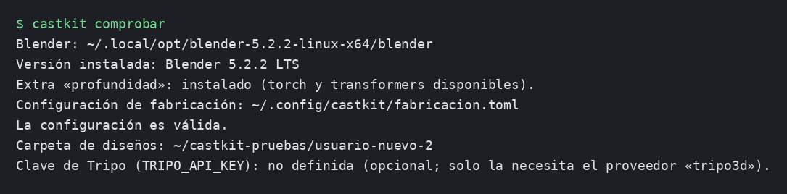
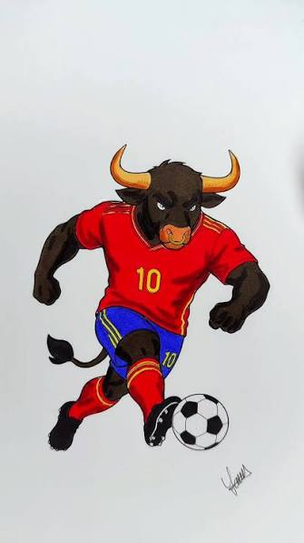
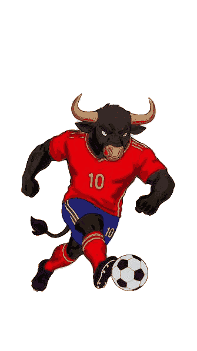
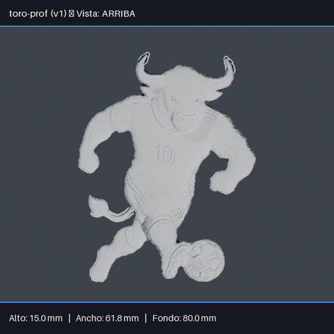
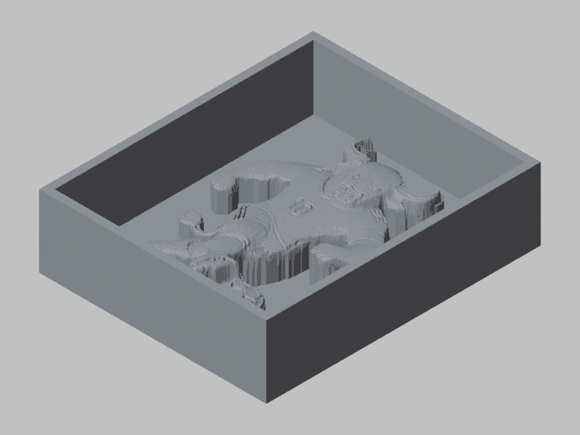

# Guía del operador: un pedido paso a paso

Esta guía te lleva por un pedido completo, de instalar castkit a tener la matriz lista para
imprimir, usando como ejemplo un pedido real: el toro futbolista (media figura, molde abierto,
en silicona). No necesitas saber de repositorios ni de la terminal más allá de copiar y pegar
los comandos de aquí; sí necesitas saber de matrices, moldes y medidas, que es lo tuyo.

Para el detalle de cada opción de cada comando (todas las que acepta, con sus valores posibles),
esta guía enlaza al [`README.md`](../README.md), que es la referencia completa. Aquí solo vas a
encontrar lo que necesitas para sacar un pedido adelante.

## 1. Instalar y comprobar

Antes de tu primer pedido hay que instalar cuatro cosas: Git, [uv](https://docs.astral.sh/uv/),
Blender y castkit. Son los mismos pasos la primera vez y cada vez que te toque dejar listo un
equipo nuevo.

**Nota:** esta forma de instalar es provisional, mientras se decide cómo se va a distribuir
castkit más adelante ([#80](https://github.com/alexisbanda/castkit/issues/80)). Por ahora se
instala directamente desde el repositorio de GitHub con Git, y tu cuenta de GitHub tiene que estar
añadida como colaboradora del repositorio (lo hace quien administra castkit en el taller).

**a) Abre la terminal.** En Windows, abre **PowerShell** desde el menú Inicio (escribe
«PowerShell» y pulsa Intro); no uses el «Símbolo del sistema» (`cmd`): los comandos de esta
guía están pensados para PowerShell. En Linux o macOS, abre tu terminal de siempre.

**b) Instala Git (si no lo tienes) y uv.**

En Windows, desde PowerShell:

```powershell
winget install --id Git.Git -e
powershell -ExecutionPolicy ByPass -c "irm https://astral.sh/uv/install.ps1 | iex"
```

Si `winget` pregunta si aceptas los términos, escribe `Y` y pulsa Intro. Si tu equipo no tiene
`winget`, instala Git con el instalador de [git-scm.com](https://git-scm.com/download/win).

En Linux o macOS:

```bash
curl -LsSf https://astral.sh/uv/install.sh | sh
```

(La mayoría de Linux y macOS ya traen Git instalado; si el comando `git` no funciona, instálalo
con el gestor de paquetes de tu sistema, por ejemplo `apt install git`.)

**c) Cierra la terminal y abre una nueva.** El instalador de uv deja todo listo, pero la terminal
donde lo instalaste no se entera: cierra esa ventana y abre una terminal nueva (en Windows, de
nuevo PowerShell) antes de seguir.

**d) Instala Blender.** castkit usa Blender por debajo para varios pasos del pipeline (el punto
de control 1, la limpieza de respaldo, etc.) y necesita la versión fijada en el proyecto,
**5.2.2 LTS**: descárgala desde [blender.org/download](https://www.blender.org/download/).

En **Windows**, descarga el instalador `.msi` y acepta la carpeta que propone: castkit lo
encuentra solo ahí, sin configurar nada más.

En **Linux/macOS**, instala Blender donde prefieras (en Linux se descomprime; en macOS se arrastra
el `.dmg` a Aplicaciones) y deja el ejecutable `blender` accesible en el `PATH`, o define la variable de entorno `BLENDER_BIN` con la ruta completa (ver
[«Definir una variable de entorno»](#definir-una-variable-de-entorno), más abajo).

Más adelante, `castkit comprobar` (paso **g**) confirma que Blender quedó encontrado y con qué
versión.

**e) Instala castkit:**

```bash
uv tool install "castkit[profundidad] @ git+https://github.com/alexisbanda/castkit.git"
```

El pedido del toro usa el proveedor `profundidad` (media figura desde una foto o dibujo frontal);
si tu taller no trabaja con medias figuras, puedes instalar sin `[profundidad]`. La primera vez
puede abrirse el navegador para que inicies sesión en GitHub —es el gestor de credenciales de Git,
que comprueba que tienes acceso al repositorio—; inicia sesión con tu cuenta y sigue. Para
actualizar más adelante: `uv tool upgrade castkit`.

**f) Cierra la terminal y abre otra nueva.** Si ves un aviso parecido a «...\.local\bin is not
on your PATH»: es normal, solo dice que esta terminal todavía no conoce el comando `castkit`.
Cierra la ventana y abre una terminal nueva; ahí el comando ya funciona.

**g) Comprueba que todo quedó en orden:**

```bash
castkit comprobar
```

Debería verse algo así (las rutas de tu equipo serán distintas):



Si alguna línea avisa de un problema (Blender no encontrado, extra `profundidad` que falta,
configuración inválida), corrígelo antes de seguir: en [«Cuando algo
falla»](#7-cuando-algo-falla), más abajo, están los casos más comunes. El detalle completo de la
instalación y de `castkit comprobar` está en el README, secciones [«Instalación para usar
castkit»](../README.md#instalación-para-usar-castkit) y [«Comprobar la
instalación»](../README.md#comprobar-la-instalación-castkit-comprobar).

### Definir una variable de entorno

Para los diseños, esta sección es **opcional**: no hace falta para dar tu primer pedido. Sin que definas nada, tus
diseños se guardan en `Documentos\castkit` (en el Explorador: «Documentos › castkit»; en Linux o
macOS, `~/Documentos/castkit` o `~/Documents/castkit`, según el idioma del sistema), y `castkit
comprobar` siempre te dice qué carpeta es.

Una **variable de entorno** es un valor que tu sistema recuerda entre comandos y entre terminales,
una vez que la defines. castkit usa estas tres:

- **`CASTKIT_DISENOS`**: si quieres guardar los diseños en otra carpeta (por ejemplo, una
  compartida en red o sincronizada con otro servicio), defínela con la ruta que prefieras.
- **`BLENDER_BIN`**: solo si instalaste Blender en una carpeta distinta a la que castkit revisa
  sola (ver [«Blender no encontrado»](#blender-no-encontrado), en [«Cuando algo
  falla»](#7-cuando-algo-falla) más abajo).
- **`TRIPO_API_KEY`**: solo si vas a usar el proveedor `tripo3d` (generación 3D en la nube).

**Windows** (en PowerShell): primero crea la carpeta, después define la variable (cambia el nombre
de la carpeta si prefieres otro):

```powershell
mkdir "$env:USERPROFILE\Documents\Diseños"
setx CASTKIT_DISENOS "$env:USERPROFILE\Documents\Diseños"
```

También puedes definirla sin comandos: busca «Editar las variables de entorno de tu cuenta» en el
menú Inicio y agrega una variable nueva con ese nombre y esa ruta. De cualquiera de las dos
formas, **abre una terminal nueva** después: ni `setx` ni ese panel afectan a la terminal que
tienes abierta, solo a las que abras después.

**Linux/macOS**: crea la carpeta y agrega la línea `export` a `~/.bashrc` (o el archivo de arranque de
tu shell); después abre una terminal nueva:

```bash
mkdir -p ~/Documentos/Disenos
export CASTKIT_DISENOS=~/Documentos/Disenos
```

El README explica cada variable con más detalle: [«Dónde se crea el
diseño»](../README.md#dónde-se-crea-el-diseño) y [«Cómo apuntar a
Blender»](../README.md#cómo-apuntar-a-blender).

## 2. Preparar el brief

Antes de dar de alta un pedido, reúne en una sola carpeta (el «brief») la imagen o imágenes que
vas a usar. Para que el resultado salga bien:

- **Fondo liso o transparente.** Si la foto tiene un fondo con textura, degradado o distinto del
  color del borde de la figura, castkit puede sacarle una placa de más a la pieza (ver el caso
  «la placa de más» en [«Cuando algo falla»](#7-cuando-algo-falla)).
- **Una sola figura por imagen.** Si el dibujo trae varias figuras o elementos sueltos, sepáralas
  en imágenes distintas antes de dar de alta.
- **Vista frontal o de perfil**, según la pieza. Para una media figura (como el toro) usa una
  vista frontal; el proveedor `profundidad` calcula el relieve a partir de esa única vista.

El pedido del toro llegó como una foto de papel con fondo degradado (`toro-original.png`, con
fondo). Antes de usarla hubo que quitarle el fondo y dejarlo transparente
(`toro-dibujo.png`):

| Foto original (con fondo) | Lista para el brief (fondo transparente) |
| --- | --- |
|  |  |

Guarda la imagen ya lista (sin fondo) en la carpeta del brief, por ejemplo
`~/pedidos/brief-toro/`. Esa es la carpeta que le vas a indicar a `castkit alta` en el siguiente
paso.

## 3. Dar de alta con la entrevista

Con el brief listo, ejecuta `castkit alta` **sin indicar un nombre**: castkit te hace una
entrevista guiada, pregunta por pregunta, con una explicación de una línea y un valor propuesto
entre corchetes que aceptas con solo pulsar Intro.

Para el pedido del toro —media figura, molde abierto, 80 mm de largo y 15 mm de grosor, en
silicona, matriz en modo cubeta con 1 cavidad, 10 piezas y entrega el 2026-11-15— la entrevista
se contesta así:

```text
$ castkit alta
Nombre del diseño: toro
Carpeta del brief: ~/pedidos/brief-toro
Encontré 1 imagen: toro-dibujo.png
¿Qué imprime castkit? 1) el molde listo para verter silicona (cubeta) 2) solo la figura, para hacer el molde aparte [1]: 1
¿Qué tipo de pieza es? 1) diseño plano (logo, escudo, medalla) 2) media figura (frente con relieve, espalda plana) 3) figura completa [2]: 2
Largo en mm [80]: 80
Grosor en mm [15]: 15
Material de la pieza final 1) porcelana-fria 2) silicona 3) cera [2]: 2
Número de cavidades [1]: 1
Cantidad a producir [1]: 10
Fecha de entrega [2026-11-15]: 2026-11-15
Licencia del modelo base [propio]: propio
Origen del modelo base: dibujo del cliente

Resumen del diseño:
1. Nombre: toro
2. Carpeta del brief: /home/usuario/pedidos/brief-toro
3. Qué imprime castkit: cubeta
4. Tipo de molde: abierto (proveedor: profundidad)
5. Medidas: largo 80 mm, grosor 15 mm
6. Material de la pieza final: silicona
7. Cavidades: 1
8. Cantidad a producir: 10
9. Fecha de entrega: 2026-11-15
10. Licencia del modelo base: propio
11. Origen del modelo base: dibujo del cliente
¿Crear el diseño? (S/n, o el número de la línea que quieres cambiar):
Diseño «toro» creado en /home/usuario/toro.
Siguiente paso: castkit flujo toro
```

Cada pregunta acepta el valor propuesto entre corchetes con solo Intro (por ejemplo, la
licencia o el número de cavidades, si ya te sirven los valores que propone). Si te equivocas en
algo, en el resumen final puedes indicar el número de la línea a corregir en vez de confirmar; si
una respuesta no es válida (por ejemplo, un formato de fecha incorrecto), castkit te dice el
motivo y repite solo esa pregunta, sin perder lo demás. El detalle de qué pregunta cada campo, y
cómo se deduce el tipo de molde y el proveedor según el tipo de pieza, está en el README, sección
[«Entrevista guiada»](../README.md#entrevista-guiada-castkit-alta-sin-nombre).

## 4. Generar con `castkit flujo`

Con el diseño dado de alta, un solo comando encadena todo el proceso de fabricación: generar la
malla, limpiarla, el canal de mecha (si aplica) y el punto de control 1, hasta la matriz:

```bash
castkit flujo toro
```

Como la entrevista del paso anterior ya guardó el proveedor (`profundidad`) y el modo de matriz
(`cubeta`) en el diseño, no hace falta repetirlos aquí. A mitad de camino, `castkit flujo` se
detiene en el punto de control 1 y te pregunta si apruebas la figura antes de seguir con la
matriz: ese es el paso siguiente de esta guía. El detalle completo del flujo (qué etapas
encadena y en qué orden) está en el README, sección [«Ejecutar el flujo
completo»](../README.md#ejecutar-el-flujo-completo-castkit-flujo).

## 5. Revisar el punto de control 1

Antes de pasar a la matriz, castkit genera cuatro renders de la figura limpia —**frente**,
**perfil**, **arriba** y **3-4**— con las medidas finales (alto, ancho y fondo en mm)
sobreimpresas. Revísalas así:

- **Frente**: la silueta de la figura, que se reconozca bien y no le falten partes.
- **Perfil**: el grosor de la pieza (en el toro, debería verse una lámina pareja de unos 15 mm;
  ni aplastada ni inflada).
- **Arriba**: el contorno visto en planta, con el largo y el ancho sobreimpresos; revisa que las
  medidas coincidan con lo que pediste (en el toro, largo 80 mm) y que no haya una placa extra de
  más alrededor de la figura (ver [«la placa de más»](#7-cuando-algo-falla) más abajo).
- **3-4**: una vista en perspectiva, la más parecida a cómo se va a ver la pieza terminada; úsala
  para una revisión general de proporciones y detalle.

Así se ve la vista «arriba» del toro, con las medidas finales sobreimpresas:



Si alguna vista no te convence, rechaza la versión con un motivo (esto bloquea el paso a la
matriz hasta que corrijas y vuelvas a generar):

```bash
castkit control1 toro --rechazar --motivo "la cara quedó aplastada"
```

Si todo se ve bien, apruébala (si ya estás dentro de `castkit flujo` en una terminal, basta con
responder que sí cuando te pregunte; si lo haces aparte):

```bash
castkit control1 toro --aprobar
```

El detalle de dónde quedan los cuatro archivos PNG y de las opciones de `castkit control1` está
en el README, secciones [«Punto de control 1»](../README.md#punto-de-control-1-renders-de-las-4-vistas-y-aprobación-castkit-control1)
y [«Opciones de `castkit control1`»](../README.md#opciones-de-castkit-control1).

## 6. La matriz y la ficha técnica

Con el punto de control 1 aprobado, `castkit flujo` (o `castkit matriz` por separado) deja en
`output/` dos archivos por versión:

- **`<diseño>_v<versión>_matriz.stl`** (en el toro, `toro_v1_matriz.stl`): el archivo que le
  mandas a la impresora 3D, ya sea de filamento (FDM) o de resina (MSLA). Es la pieza que imprimes
  tal cual, sin retocarla.
- **`<diseño>_v<versión>_ficha.md`**: la ficha técnica en texto, con el material de la pieza
  final, el modo de matriz (figura o cubeta), las cavidades, el tipo de molde y sus medidas, las
  dimensiones exteriores de la matriz, el volumen por figura y, en modo cubeta, los mililitros
  de silicona estimados, además de una advertencia de taller según el material (por ejemplo,
  recordar el desmoldante en moldes de silicona sobre silicona).

Así se ve la matriz del toro (modo cubeta, 1 cavidad), vista en perspectiva:



Los modos `figura` y `cubeta` escriben siempre el mismo nombre de archivo: si generas los dos
para la misma versión, el segundo pisa al primero. Si necesitas conservar ambos, copia el
`.stl` a otro nombre antes de generar el segundo modo. El detalle completo (todas las opciones y
el contenido exacto de la ficha técnica) está en el README, secciones [«Generar la matriz
imprimible»](../README.md#generar-la-matriz-imprimible-stl-en-modo-figura-o-cubeta),
[«Ficha técnica»](../README.md#ficha-técnica) y [«Opciones de `castkit
matriz`»](../README.md#opciones-de-castkit-matriz).

## 7. Cuando algo falla

Estos son los problemas más comunes, con el mensaje tal cual lo vas a ver (las partes entre
`<…>` cambian según tu caso) y qué hacer en cada uno.

### Blender no encontrado

Lo vas a ver al correr `castkit control1` o `castkit flujo` (el punto de control 1 necesita
Blender siempre, sin alternativa):

```text
No se puede generar el punto de control 1 sin Blender: No se encuentra Blender 5.2.2: instálalo desde blender.org y asegúrate de que el comando 'blender' esté en el PATH, o bien define la variable de entorno BLENDER_BIN con la ruta completa al ejecutable, por ejemplo añadiendo `export BLENDER_BIN=/ruta/a/blender` a ~/.bashrc y abriendo una terminal nueva.
```

**Qué hacer**: instala Blender en la versión fijada (puedes verla ejecutando `castkit comprobar`,
que también la compara con la que tengas instalada).

- **Windows**: si lo instalaste con el instalador de blender.org (el `.msi`), castkit lo
  encuentra solo, sin que tengas que hacer nada más. Si lo instalaste en otra carpeta, define
  `BLENDER_BIN` en PowerShell: `setx BLENDER_BIN "C:\ruta\a\blender.exe"` y abre una terminal
  nueva.
- **Linux/macOS**: define la variable de entorno `BLENDER_BIN` con la ruta completa al
  ejecutable, por ejemplo añadiendo `export BLENDER_BIN=/ruta/a/blender` a `~/.bashrc` y abriendo
  una terminal nueva.

Más sobre cómo castkit busca Blender, en el README, sección [«Cómo apuntar a
Blender»](../README.md#cómo-apuntar-a-blender).

### El extra `profundidad` no está instalado

Lo vas a ver si tu pedido usa el proveedor `profundidad` (medias figuras) y lo instalaste sin
ese extra:

```text
El proveedor profundidad necesita el extra opcional: uv sync --extra profundidad
```

**Qué hacer**: si instalaste castkit como herramienta (lo habitual en el taller), reinstálalo
con el extra:

```bash
uv tool install --reinstall "castkit[profundidad] @ git+https://github.com/alexisbanda/castkit.git"
```

(El mensaje menciona `uv sync --extra profundidad`, que es la forma equivalente para quien
trabaja desde un clon del repositorio en modo desarrollo.)

### La placa de más por el fondo de la foto

Este caso no deja un mensaje de error: el resultado se genera, pero sale con una lámina extra
alrededor de la figura, pegada a su base. Pasa cuando la foto de origen tiene un fondo que no es
uniforme (una foto de papel con sombra o degradado, por ejemplo): el proveedor `profundidad` toma
el color del borde de la imagen como si fuera el fondo, y si ese borde no es parejo, confunde
parte del fondo con la figura.

**Qué hacer**: lo ves en el render «arriba» del punto de control 1 (paso 5) como una placa
rectangular sobrante alrededor de la silueta. Vuelve a la imagen original, quítale el fondo
dejándolo transparente (como se hizo con `toro-dibujo.png` en el paso 2, comparado con
`toro-original.png`) y repite `castkit generar` (o `castkit flujo` completo) con la imagen
corregida.

### La limpieza rechaza la malla por quedar lejos de la original (remallado de respaldo)

Cuando la malla en bruto no cierra por sí sola, castkit reintenta automáticamente remallándola
por vóxeles dentro de Blender; ese remallado no siempre es fiel, y si se aleja demasiado de la
figura original, `castkit limpieza` (o `castkit flujo`) lo rechaza:

```text
El remallado de respaldo con Blender deformó la figura: la distancia máxima a la malla original es <distancia> mm, mayor que la tolerancia configurada (<tolerancia> mm). No se escribió ningún archivo. Siguientes pasos: corrige el modelo y vuelve a hacer "castkit ingesta" con una malla nueva.
```

Por ejemplo, con una guagua de pan el remallado de respaldo llegó a alejarse 3,5 mm de la
original: hoy este remallado casi nunca entrega piezas fieles cuando la malla de entrada está muy
abierta (ver [#28](https://github.com/alexisbanda/castkit/issues/28)).

**Qué hacer**: no hay forma de forzar que el remallado quede fiel; corrige el modelo de origen
(una malla o imagen con menos huecos abiertos) y vuelve a generarlo. Más sobre cuándo se usa este
respaldo, en el README, sección [«Respaldo con Blender (remallado por
vóxeles)»](../README.md#respaldo-con-blender-remallado-por-vóxeles).

### Fecha o medida inválida en el alta

Si escribes una fecha o una medida con un formato que castkit no reconoce (al dar de alta con
`nombre` y opciones, fuera de la entrevista guiada), vas a ver mensajes como estos:

```text
--fecha debe ser una fecha AAAA-MM-DD válida; recibido "<valor>".
--largo-mm debe ser un número mayor que 0; recibido "<valor>".
--grosor-mm debe ser un número mayor que 0; recibido "<valor>".
```

**Qué hacer**: corrige el valor con el formato pedido (la fecha, como `2026-11-15`; las medidas,
un número mayor que 0, con punto decimal, como `12.5`) y repite el comando. Si en cambio usas la
entrevista guiada del paso 3, castkit te avisa del mismo problema ahí mismo y repite solo esa
pregunta, sin perder las respuestas anteriores.
